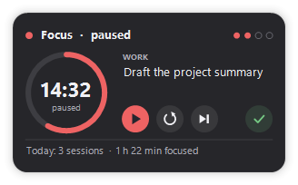
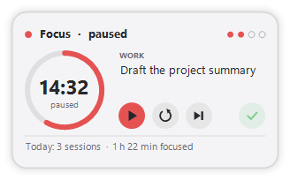

# Kinetik Focus: focus timer widget for the Windows desktop

**Kinetik Focus** is a free, open-source **focus timer for Windows 11 and Windows 10**. You work in timed sessions with breaks between them, Pomodoro style. Pick the task you're working on straight from a folder of Markdown notes, like your [Kinetik Notes](https://github.com/WastedDesigner/KinetikNotes) or Obsidian folder, and tick it off in its file when it's done.

It's a small portable app with no installer and no account. It's a companion to [Kinetik](https://github.com/WastedDesigner/Kinetik), the taskbar system monitor, and shares its look.

  
  

> **About this project:** I made this for my own desktop and decided to share it in case anyone else finds it useful. If you run into a bug or have an idea for a feature, please open an issue.

## Features

- **Focus sessions and breaks:** 25 minutes of focus, then a 5-minute break, with a 15-minute break after every four sessions. Every length can be changed. Breaks can start by themselves, and so can the next session.
- **Ring and countdown:** time left, when the session ends, and a dot for each session done in this round
- **Tasks from your notes:** click the task area to pick any open task (`- [ ] …`) from Kinetik Notes' folder, or another folder of Markdown files, or type one in
- **Tick it off:** the ✓ button marks the task done in its Markdown file, changing only that line, so Kinetik Notes and Obsidian see it at once
- **Kinetik stays quiet:** while a session runs, Kinetik (the taskbar bar) holds back its warnings (hot CPU or GPU, high ping, low drive space, low battery). Any that still apply show up after the session.
- **A soft chime** and a notification when a session or break ends
- **Ctrl+Alt+F** starts and pauses from anywhere. Left-clicking the tray icon does the same.
- **Log:** every session is added to a CSV file (date, start, minutes, task, note), and the widget shows today's total
- **Keeps going through a restart:** a running timer picks up where it was
- **Themes** in Kinetik's style, a choice of fonts, size and background opacity; on the desktop, a normal window or always on top
- **Settings backup** next to the exe, offered again on a fresh Windows

## Download and use

1. Download `KinetikFocus.zip` from Releases and extract it anywhere.
2. Run `KinetikFocus.exe`, click the task area to pick a task, and press ▶.
3. Right-click the widget or the tray icon for timer lengths, style, placement and backup.

Settings are kept in `HKCU\Software\KinetikFocus`, and the log in `%LOCALAPPDATA%\KinetikFocus\focus-log.csv`. The app makes no network connections. It only reads the Markdown files in the tasks folder, and writes the one line of a task you tick off.

## Requirements

Windows 10 or 11 (64-bit) with .NET Framework 4.8, which ships with both. Holding back Kinetik's alerts needs a version of Kinetik newer than 3.1.0.

## Building from source

No SDK needed: `build.bat` compiles `KinetikFocus.cs` with the .NET Framework compiler that ships with Windows. `build.bat package` also makes `KinetikFocus.zip` for a release.

`KinetikFocus.exe --demo` runs a separate copy with a made-up session that reads and saves no settings. Add `--theme Light` (or any theme name) to pick its theme, and `--shot file.png` to draw the card into a PNG and quit, which is how the screenshots were made.

## License

[GPL-3.0-or-later](LICENSE). Copyright © 2026 Akila Sella Hennedige.

## Local maintenance build 1.0.1

Includes the approved 16 October 2026 diagnostics fixes. Cross-compilation and regression results are recorded in the Apps diagnostics report; Windows GUI and hardware validation remains pending. Run `python tests/run-tests.py` for non-GUI regressions, and `build.bat package` to compile and create a hash-verified release package. Shared support is compiled into the EXE; no additional runtime DLL is required.

Note edits retain the previous bytes in a `.kinetik-recovery` folder beside the note. Concurrent changes are refused when detected before replacement; a change in the final replacement gap is preserved there and reported as a conflict. Refresh or reselect a changed task before retrying.
